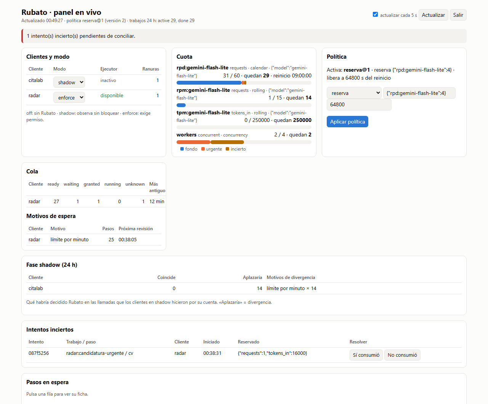
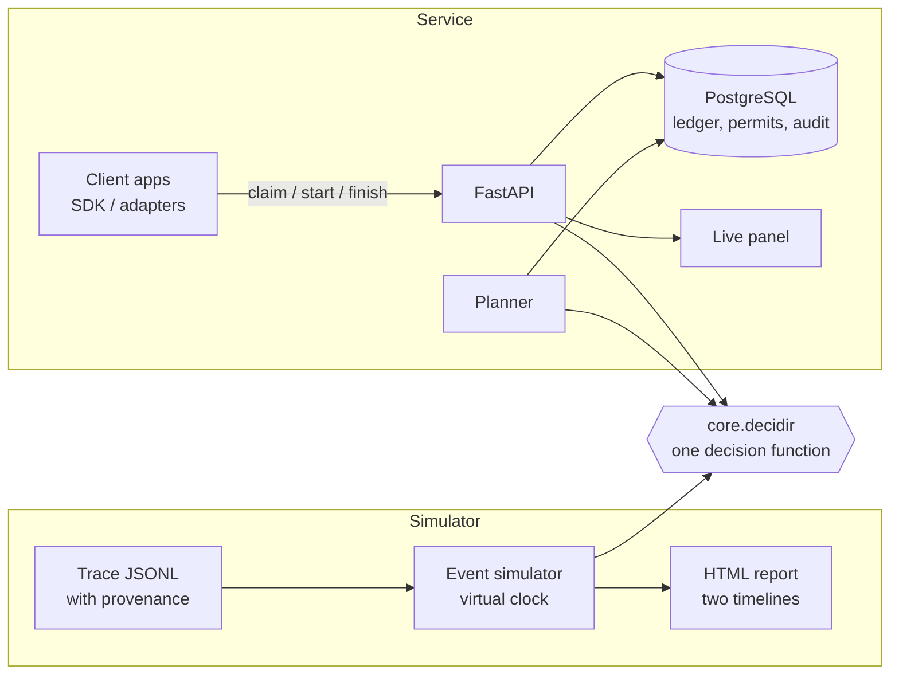
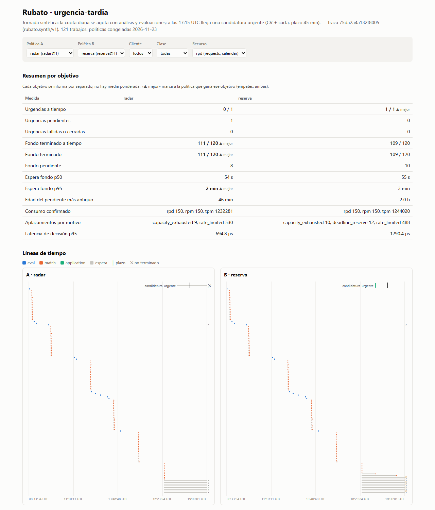

<div align="center">

# Rubato

**Admission control for AI workloads that share one quota.**

Decide which work runs now and which waits, explain why, say when it will be
reconsidered, and measure what a policy change costs and to whom.

[](https://github.com/Andros5/rubato/actions/workflows/ci.yml)
[](https://github.com/Andros5/rubato/releases)
[](pyproject.toml)
[](LICENSE)

</div>

---

Several applications calling the same model provider share its limits: requests per
minute, requests per day, tokens per minute, money. When a background batch has used the
daily quota, the urgent request that arrives at 17:15 fails. Raising the limit is not
always possible. Rubato makes the trade-off explicit instead.

- A **simulator** replays a day of work under different policies before you touch the
  provider. It needs no credentials.
- A **service** gives permits to several applications. Accounting is transactional,
  operations are idempotent and uncertain attempts are recovered.
- Both call **the same decision function**. What you simulate is what runs.

<p align="center">
  
  <br><sub>Live panel (synthetic data). Quota per resource, per-client mode switch, active policy, waiting reasons, shadow-phase divergences and one-click reconciliation.</sub>
</p>

## Features

- **Explainable decisions.** Every *authorize / defer / close* has a stable reason
  (`deadline_reserve`, `capacity_exhausted`, `rate_limited`, `provider_pause`, …), the
  number that decided it, and the instant it will be reconsidered.
- **Policies.** Arrival order, a priority reference, and an **urgent reserve** with
  release time, anti-starvation and an impossible-deadline rule. Policy parameters are
  versioned.
- **Real limits.** Rolling windows, calendar windows with time zones (including 23-hour
  DST days), concurrency, totals, tokens and integer money with versioned tariffs, and
  429 pauses with `Retry-After`.
- **Several providers.** Each step names its provider; limits can be scoped to a
  provider, a model and a client, so each client gets its own share of each provider.
- **Honest data.** Every trace field carries its provenance (`observed`, `derived`,
  `synthetic`, `hypothetical`), and reports never mix them.
- **Offline optimum.** An exhaustive search and an OR-Tools CP-SAT solver compute the
  perfect-information bound for small instances, so a policy can be compared against
  what was achievable.
- **Transactional service.** It reserves every limit or none, uses idempotency keys and
  permit expiry, and keeps uncertain attempts conservatively booked until they are
  reconciled with the provider's receipt.
- **Gradual adoption.** Each client runs `off`, `shadow` (observe, never block) or
  `enforce`. The mode is switched from the panel and applied within 30 s.
- **Operations.** Prometheus metrics, JSON logs with correlation ids, restore and
  failover drills, Docker Compose and Kubernetes manifests.

## How it works



A client registers a job and its steps, asks for a permit, confirms the start
*before* calling the provider, and settles the real usage afterwards. If it crashes
before starting, the permit expires and the step is offered again. If it crashes after
starting, the attempt becomes `unknown` and stays booked until it is reconciled, so it
is never retried blindly.

## Quick start

### Simulator (no keys, no network)

```bash
pip install -e ".[dev]"            # or the wheel from the latest release
rubato init-demo .                 # synthetic trace, scenarios and frozen policies
rubato simulate --trace examples/demo.jsonl --scenario urgencia-tardia \
                --policies radar,reserva --out runs/demo
rubato compare --run runs/demo --report informe.html
rubato explain --run runs/demo --policy radar --job candidatura-urgente
```

```text
radar: candidatura-urgente (radar/application) arrived 17:15:00 UTC [hypothetical], deadline 18:00:00 UTC
  17:15:00 UTC cv#1 DEFER [capacity_exhausted] rpd: needs 1, 0 available; reconsider 08:00:00 UTC
  result: pending
```

With a 4-request urgent reserve, the same application finishes on time. Two background
analyses pay for it, and the report shows that cost rather than hiding it:

<p align="center">
  
</p>

### Service

```bash
docker compose up --build -d                 # PostgreSQL, API, planner, simulated provider
# open http://127.0.0.1:8000/panel          (admin token from RUBATO_CLIENTS)
rubato status --token <admin-token>          # the same view in the terminal
rubato why radar:<job-id> --token <admin-token>   # every decision about a live job
```

To integrate an application:

```python
from rubato.sdk import Gate, Outcome, RubatoClient

gate = Gate(RubatoClient("http://127.0.0.1:8000", token), mode="auto")  # follows the panel switch
gate.register({"id": "job-42", "class": "match",
               "steps": [{"id": "s", "model": "gemini-flash", "estimate": {"requests": 1},
                          "maximum": {"requests": 1}}]})
result = gate.run("job-42", "s", lambda: (call_provider(), Outcome("ok", {"requests": 1})))
```

Set your own tokens in `RUBATO_CLIENTS` (for example in a git-ignored `.env`) before
exposing the service. For tests and demos, `RUBATO_TEST_CLOCK=1` enables the reset and
clock endpoints.

## Results

On a synthetic working day (120 jobs, 150 requests per day), the urgent reserve:

| Scenario | Reference: urgent / background done | Reserve: urgent / background done |
|---|---|---|
| Late urgent application (17:15) | 0/1 · 111/120 | **1/1** · 109/120 |
| Early urgent application (11:00) | 1/1 · 109/120 | 1/1 · 109/120 |
| Day without urgency | 0/0 · 111/120 | 0/0 · 111/120 (p95 wait 109 → 165 s) |
| Demand peak ×2 | 0/1 · 105/240 | **1/1** · 104/240 |
| Quota cut to 70 % | 0/1 · 72/120 | **1/1** · 70/120 |
| Another app consumes 40 requests | 0/1 · 76/120 | **1/1** · 75/120 |

On 13 days of real history from the author's job-search assistant, the reserve **tied**
the reference: the urgent jobs missed there failed because of invalid outputs and long
retries, not because of quota. The reference policy therefore stays the default. The
evaluation protocol (design, tuning and test blocks, with thresholds frozen beforehand)
and its limits are in [`docs/evaluacion.md`](docs/evaluacion.md).

Performance on a laptop: one week of real history (2,133 jobs) simulates in 1.45 s,
with a p95 per decision round of 0.54 ms. On the service, `claim` takes about 14 ms median and
25 ms p95 server-side in Kubernetes with two replicas. A failover drill (one replica killed during a
reservation, another during a provider call) gave 0 duplicate permits and 0 balance
discrepancy.

## Project layout

```text
src/rubato/
  core.py, policies.py, resources.py   decision function, policies, ledger
  sim.py, metrics.py, optimize.py      simulator, objective-by-objective metrics, offline optimum
  trace.py, synth.py, capture.py       trace format, synthetic generator, prospective capture
  report.py, explain.py, evaluate.py   HTML report, explanations, date-block evaluation
  service/                             FastAPI app, PostgreSQL store, planner, panel, migrations
  sdk.py                               client and Gate (off / shadow / enforce / auto)
examples/        synthetic demo trace, scenarios, frozen policies, versioned results
deploy/          Kubernetes manifests (kind); compose.yaml at the root
scripts/ops/     restore and failover drills, cluster bootstrap, Windows autostart
docs/            guides, references, ADRs, evaluation, development notes
tests/           behaviour tests (simulator, service on real PostgreSQL, adapters)
```

## Documentation

| Document | Content |
|---|---|
| [Guide (ES)](docs/guia.md) | Reading reasons, using your own load, the live panel |
| [CLI and API reference](docs/referencia.md) | Every command and endpoint |
| [Trace format](docs/trazas.md) | `rubato.trace/v1`, provenance, prospective capture |
| [Service](docs/servicio.md) · [Operations](docs/operacion.md) | Accounting, concurrency, runbook, drills |
| [Integrations](docs/integraciones.md) | Adapters for two real applications, rollout and rollback |
| [Design decisions](docs/decisiones.md) · [ADRs](docs/adr/) | Strict caps vs estimates, online policy vs optimum, uncertain attempts |
| [Evaluation](docs/evaluacion.md) | Scenarios, real-history verdict, when the reserve did worse |
| [Changelog](CHANGELOG.md) | Release notes |

## Development

```bash
pip install -e ".[dev]"
pytest -q                                                      # no network, no keys
RUBATO_TEST_CLOCK=1 docker compose up -d --build
RUBATO_TEST_API=http://127.0.0.1:8000 pytest -q -m postgres   # service on real PostgreSQL
ruff check src tests scripts && ruff format --check src tests scripts
```

See [CONTRIBUTING.md](CONTRIBUTING.md). Security issues: [SECURITY.md](SECURITY.md).

## Roadmap

- Rolling-horizon planning once enough prospective days with observed arrivals exist.
- Model selection by quality per class, which needs quality data, not only price.
- A usability pilot with the maintainer of another AI automation.

## License

MIT © Andros5. If you use Rubato in research, see [`CITATION.cff`](CITATION.cff).
